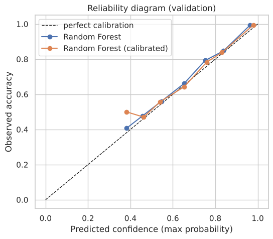
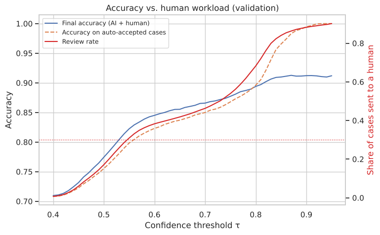
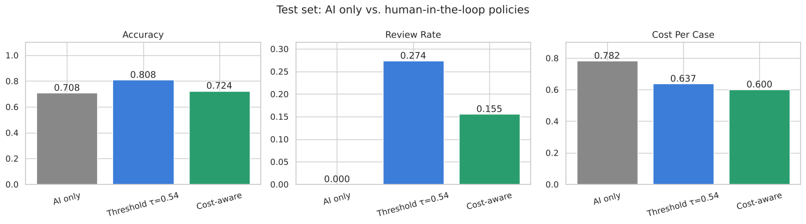
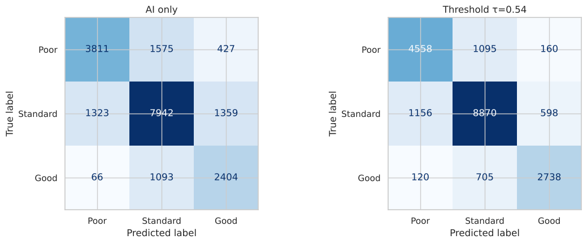
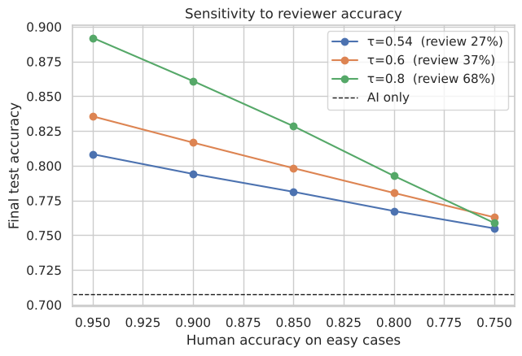
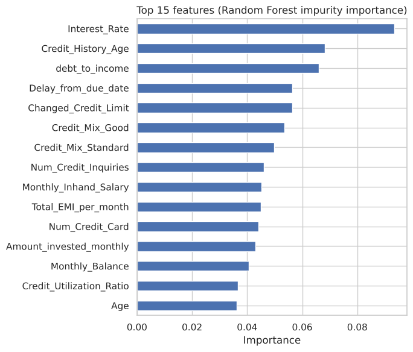

# Credit Score Classification with Human-in-the-Loop

A Random Forest model sorts customers into **Good**, **Standard** or **Poor** credit scores. Cases the model is unsure about go to a human reviewer. The project measures how much human review improves accuracy, how much reviewer work that costs, and how to choose the point where a case is handed over.

| | Accuracy | Cases sent to a human |
|---|---|---|
| Model alone | **0.708** | 0% |
| Model + human review (τ = 0.54) | **0.808** | 27% |

*Test-set results on customers the model never saw. The human reviewer is simulated (see [Limitations](#limitations)).*

---

## Contents

- [How it works](#how-it-works)
- [Results](#results)
- [Quick start](#quick-start)
- [Repository structure](#repository-structure)
- [Configuration](#configuration)
- [Data](#data)
- [Limitations](#limitations)
- [Methodology in detail](docs/methodology.md)

---

## How it works

```
                 ┌────────────────────┐
  customer  ───► │ Calibrated Random  │ ── confidence ≥ τ ──► automatic decision
   record        │ Forest classifier  │
                 └────────────────────┘ ── confidence < τ ──► human reviewer ──► final decision
```

1. **Features.** 20 inputs (17 numeric, 3 categorical), including an engineered `debt_to_income` ratio. Identifiers and free-text fields are dropped.
2. **Customer-level split.** Every customer has 8 monthly records. Data is split by `Customer_ID` into train (64%), validation (16%) and test (20%), so no customer appears in more than one set.
3. **Calibrated model.** A Random Forest (300 trees) is wrapped in isotonic calibration, using folds that are also grouped by customer. Its confidence (the highest class probability) then matches its real accuracy.
4. **Routing.** A case goes to a human when confidence falls below the threshold τ. τ is chosen on the validation set: the highest-accuracy value that sends at most 30% of cases to a human.
5. **Cost-aware alternative.** A second policy weighs the cost of each kind of mistake (for example, rating a *Poor* customer as *Good*) against the cost of a human review.

---

## Results

### 1. The original row-level split overstated accuracy

| Split method | Accuracy (Random Forest) |
|---|---|
| Random row split (original notebooks) | 0.831 |
| Customer-level split (this project) | 0.704 |

With a random row split, the model has already seen other months of the same customer during training. The 13-point gap is that leakage. The customer-level figure is the realistic estimate for new customers.

### 2. Model comparison (validation set)

| Model | Accuracy | Macro F1 | Log loss |
|---|---|---|---|
| Random Forest | 0.704 | 0.681 | 0.649 |
| **Random Forest, calibrated** | **0.707** | **0.688** | **0.640** |
| HistGradientBoosting | 0.703 | 0.677 | 0.666 |

The calibrated Random Forest is used from here on. Gradient boosting gave no improvement.



### 3. Accuracy vs. reviewer workload

Raising τ sends more cases to humans and raises accuracy. The dotted line marks the 30% review limit.



| τ | Sent to a human | Final accuracy |
|---|---|---|
| 0.50 | 17% | 0.774 |
| **0.54 (chosen)** | **29%** | **0.814** |
| 0.60 | 38% | 0.845 |
| 0.70 | 46% | 0.866 |
| 0.80 | 68% | 0.894 |

*Validation set.*

### 4. Final test-set comparison

| Policy | Accuracy | Macro F1 | Sent to a human | Cost per case* |
|---|---|---|---|---|
| Model alone | 0.708 | 0.687 | 0% | 0.78 |
| Threshold τ = 0.54 | **0.808** | **0.797** | 27% | 0.64 |
| Cost-aware | 0.724 | 0.635 | 16% | **0.60** |

\*Calculated from placeholder costs. Replace them with real business costs before drawing conclusions (see [Configuration](#configuration)).




### 5. Sensitivity to reviewer accuracy

Human review helps only as much as the reviewers are accurate:

| Reviewer accuracy (easy cases) | τ = 0.54 | τ = 0.60 | τ = 0.80 |
|---|---|---|---|
| 95% | 0.808 | 0.836 | 0.892 |
| 85% | 0.781 | 0.798 | 0.828 |
| 75% | 0.755 | 0.763 | 0.759 |



### 6. What drives the predictions

`Interest_Rate`, `Credit_History_Age`, `debt_to_income`, `Delay_from_due_date` and `Changed_Credit_Limit` are the most important features.



---

## Quick start

```bash
git clone https://github.com/<your-username>/<your-repo>.git
cd <your-repo>
python -m venv .venv && source .venv/bin/activate   # Windows: .venv\Scripts\activate
pip install -r requirements.txt

# download the dataset from Kaggle and save it as data/credit_score_train.csv (see data/README.md)
jupyter notebook notebooks/Credit_Score_HITL_RF_Improved.ipynb
```

Run all cells. The full notebook takes about 3 minutes on a laptop.

---

## Repository structure

```
.
├── README.md
├── requirements.txt
├── data/
│   └── README.md                 # where to get the dataset and its expected format
├── docs/
│   ├── methodology.md            # detailed write-up of every design decision
│   └── images/                   # charts used in this README
└── notebooks/
    ├── Credit_Score_HITL_RF_Improved.ipynb   # main notebook (with outputs)
    └── original/                             # first versions, kept for comparison
        ├── Credit_Score_Train_Model_LR.ipynb
        └── Credit_Score_Train_Model_RF.ipynb
```

---

## Configuration

All settings are at the top of the notebook or in the section where they are used:

| Setting | Default | Meaning |
|---|---|---|
| `HUMAN_ACC_EASY` | 0.95 | Simulated reviewer accuracy on cases the model is fairly sure about |
| `HUMAN_ACC_HARD` | 0.85 | Simulated reviewer accuracy on the hardest cases |
| `MAX_REVIEW_RATE` | 0.30 | Maximum share of cases that may go to a human |
| `COST` | see notebook | Cost of each (true, predicted) mistake. **Placeholder values** |
| `REVIEW_COST` | 0.6 | Cost of one human review, in the same units as `COST` |
| `RANDOM_STATE` | 42 | Seed for the splits, models and simulation |

---

## Data

Kaggle, based on [Credit score classification](https://www.kaggle.com/datasets/parisrohan/credit-score-classification) by Rohan Paris (cleaned version: 12,500 customers × 8 months). The data is not included in this repository; see [data/README.md](data/README.md).

---

## Limitations

- **The human reviewer is simulated.** Reviewer accuracy is an assumption, not a measurement. Before relying on the HITL figures, collect real reviewer decisions.
- **The costs are placeholders.** The cost-aware results mean something only once the cost matrix reflects real losses.
- **Months are treated independently.** Each monthly record is classified on its own. Features built from a customer's history over the months could raise the model's accuracy and reduce how many cases need review.
- **Hyperparameters are mostly defaults.** A grouped cross-validation search was not run.

## Next steps

- Add features describing each customer's history (trends and changes from month to month).
- Tune the models with `GroupKFold`.
- Replace the simulated reviewer with logged human decisions.
- Feed reviewed cases back into training (active learning).
