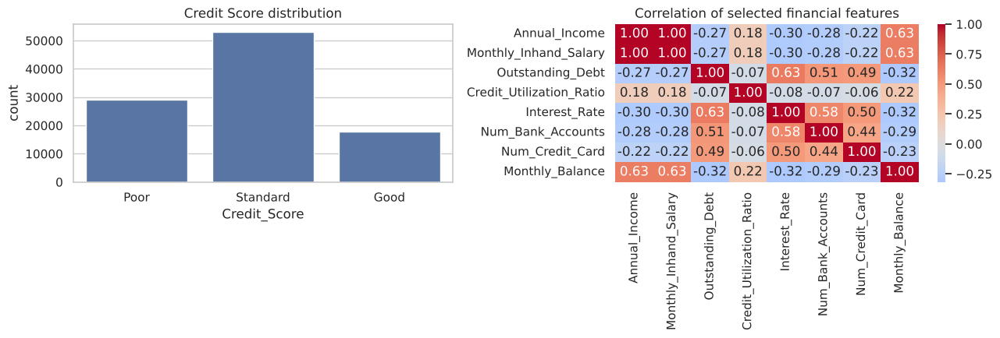

# Methodology

This document explains each design decision in `notebooks/Credit_Score_HITL_RF_Improved.ipynb` and why it was made. For the headline results, see the [README](../README.md).

## 1. Data

- 100,000 rows and 28 columns: 12,500 customers × 8 monthly records.
- Target: `Credit_Score` with 3 classes, which are imbalanced:

  | Class | Rows | Share |
  |---|---|---|
  | Standard | 53,174 | 53% |
  | Poor | 28,998 | 29% |
  | Good | 17,828 | 18% |



## 2. Features

**Dropped columns**

| Column | Reason |
|---|---|
| `ID`, `Customer_ID`, `Name`, `SSN` | Identifiers with no predictive meaning, and a privacy risk |
| `Type_of_Loan` | Free text with many unique combinations |
| `Payment_Behaviour` | Excluded in the original feature set |
| `Credit_Score` | The target |

**Engineered feature**

`debt_to_income = Outstanding_Debt / Annual_Income`. It replaces both of its source columns. Zero incomes are treated as missing so the ratio is never infinite.

**Preprocessing**

All preprocessing is inside a scikit-learn `Pipeline`, so it is fit on training data only:

- `Occupation`, `Credit_Mix`, `Payment_of_Min_Amount` → `OneHotEncoder(handle_unknown="ignore")`
- the 17 numeric columns → `StandardScaler`. Trees don't need scaling; it is kept so other models can be swapped in.

## 3. Customer-level split

Rows from the same customer are highly similar from month to month. If one customer's months land in both train and test, the model can partly memorise the customer instead of learning general patterns.

| Method | RF accuracy |
|---|---|
| `train_test_split` on rows | 0.831 |
| `GroupShuffleSplit` on `Customer_ID` | 0.704 |

The notebook uses two grouped splits:

```
all customers ─┬─ 20% ─► TEST        used once, at the end
               └─ 80% ─┬─ 20% ─► VALIDATION   chooses τ and compares policies
                       └─ 80% ─► TRAIN        fits the models
```

An `assert` checks that no customer appears in two sets.

## 4. Models

| Model | Settings |
|---|---|
| Random Forest | 300 trees, `min_samples_leaf=2`, `n_jobs=-1` |
| Random Forest, calibrated | the above, wrapped in `CalibratedClassifierCV(method="isotonic")` |
| HistGradientBoosting | 300 iterations, learning rate 0.08, used as a comparison |

**Why calibrate?** HITL routing treats `max(predict_proba)` as "how likely the model is to be right". For τ to mean anything, cases with 0.8 confidence need to be correct about 80% of the time. Calibration is fit with 5 `GroupKFold` folds. With ungrouped folds, the calibration would be fit on leaked rows and come out overconfident.

On this data the raw forest was already close to calibrated. Calibration improved log loss slightly (0.649 → 0.640) and accuracy barely changed.


## 5. Simulated human reviewer

The original notebooks assumed a flat 95% reviewer accuracy. Cases the model finds hard are usually harder for people too, so here reviewer accuracy depends on difficulty:

```
difficulty  = (1 − confidence) / (1 − 1/3)           # 0 = easy, 1 = hardest
P(correct)  = ACC_EASY − (ACC_EASY − ACC_HARD) × difficulty
```

With the defaults (`ACC_EASY = 0.95`, `ACC_HARD = 0.85`), a wrong reviewer picks one of the other two classes at random. The simulation uses a fixed seed so results are reproducible.

## 6. Routing policies

### 6.1 Confidence threshold

```
if max(P) ≥ τ:  use the model's prediction
else:           send to a human
```

τ is swept from 0.40 to 0.95 in steps of 0.01 on the **validation** set. The chosen τ is the one with the highest final accuracy among values that send at most `MAX_REVIEW_RATE` (30%) of cases to a human. This gave **τ = 0.54**.

### 6.2 Cost-aware routing

Not all mistakes cost the same. Costs are given as a matrix `COST[true, predicted]`:

| true \ predicted | Good | Standard | Poor |
|---|---|---|---|
| **Good** | 0 | 1 | 3 |
| **Standard** | 2 | 0 | 2 |
| **Poor** | **10** | 3 | 0 |

*Placeholder values: replace them with real business costs.*

For each case, using the calibrated probabilities `P`:

1. Expected cost of each possible decision: `P @ COST`.
2. The model's best option is the decision with the lowest expected cost.
3. Expected cost of a human review: `REVIEW_COST + P(human wrong) × average mistake cost`.
4. The case goes to a human if the model's best option costs more than a review.

This policy can choose a different label from the most probable one. For example, it prefers *Standard* over *Good* when there is a real chance the customer is *Poor*. That is why its accuracy and macro F1 are lower than the threshold policy's while its cost is lower too.

## 7. Evaluation

The test set is used once, after τ and all settings have been fixed on validation data.

| Policy | Accuracy | Macro F1 | Sent to a human | Cost per case |
|---|---|---|---|---|
| Model alone | 0.708 | 0.687 | 0% | 0.78 |
| Threshold τ = 0.54 | 0.808 | 0.797 | 27% | 0.64 |
| Cost-aware | 0.724 | 0.635 | 16% | 0.60 |

Per-class results for the threshold policy (test set):

| Class | Precision | Recall | F1 |
|---|---|---|---|
| Good | 0.783 | 0.768 | 0.776 |
| Poor | 0.781 | 0.784 | 0.783 |
| Standard | 0.831 | 0.835 | 0.833 |


## 8. Sensitivity analysis

The test evaluation is repeated with weaker reviewers: easy-case accuracy from 0.95 down to 0.75, with hard-case accuracy always 10 points lower. At 75% reviewer accuracy, sending more cases to humans no longer helps. Accuracy at τ = 0.8 (0.759) is slightly *below* τ = 0.6 (0.763), because the reviewers are then barely better than the model on the cases they receive.

## 9. Changes from the original notebooks

| Issue in the original | Fix |
|---|---|
| Random row split leaked customers into test | `GroupShuffleSplit` by `Customer_ID` |
| Charts used hard-coded numbers | All charts are drawn from computed results |
| The reported "AI + Human" accuracy actually came from τ = 0.9 (a loop variable that had been overwritten), not the stated τ = 0.7 | Each policy is evaluated in its own clearly named variables |
| τ chosen without a held-out set | τ chosen on validation, reported on test |
| Uncalibrated probabilities used as confidence | Isotonic calibration with grouped folds |
| Flat 95% human accuracy | Accuracy depends on difficulty, plus a sensitivity analysis |
| `robs` typo | Removed |
